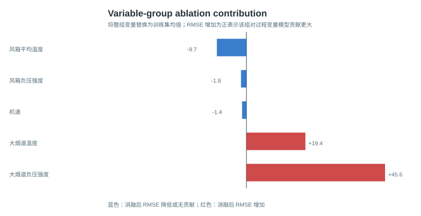
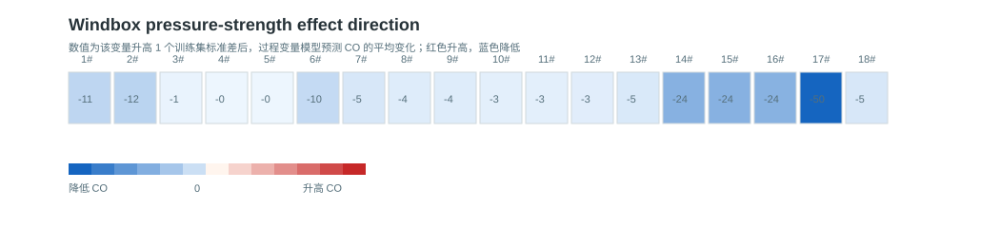
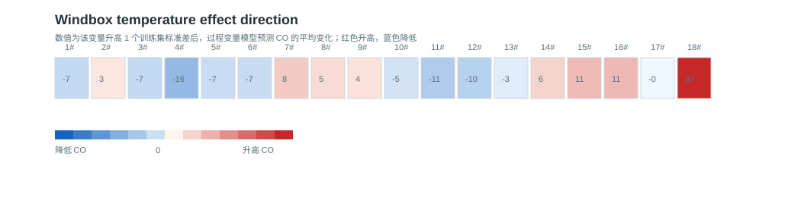
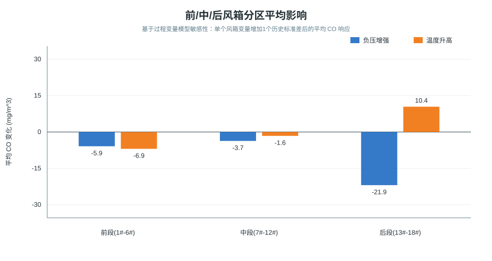
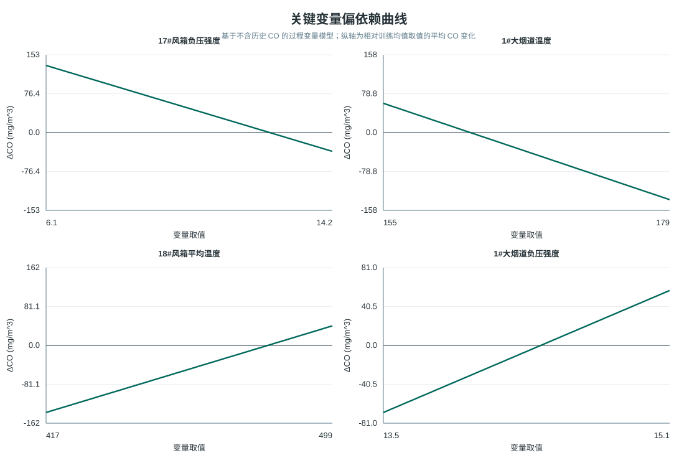

# 第2问：CO 浓度预测与过程变量影响规律

## 1. 问题目标与总体思路

第2问需要同时完成两件事：一是建立能够在线预测 `烧结大烟道外排CO浓度` 的模型，二是解释风箱负压、风箱温度、大烟道负压和大烟道温度等过程变量对 CO 的影响规律。二者目标不同，因此模型分工不同，但本文不再把“修正异常值建模”和“原始数据建模”拆成两篇报告，而是统一写成一篇完整的第二问说明。

本文保留两个数据口径：`异常修正后口径` 作为主口径，`原始 CO 口径` 作为稳健性对照。两个口径使用相同的数据清洗、时滞配准、特征构造和模型体系，区别只在于是否对 CO 异常尖点进行线性修正。

| 任务 | 使用模型 | 输入 | 主要用途 |
|---|---|---|---|
| 实时预测 | 监测型融合模型 | 历史 CO + 时滞配准后的过程变量 | 在线预测当前或短时 CO 浓度，并给第3问提供状态条件下的预测接口 |
| 影响规律解释 | 过程变量模型 | 不含历史 CO，仅含机速、风箱负压强度、风箱平均温度、大烟道负压强度和温度 | 解释过程变量的方向、敏感性和空间分区差异 |
| 非线性补充 | 非线性过程变量模型 | 不含历史 CO 的过程变量 | 用 permutation importance 检查非线性条件下的变量重要性 |

原始负压字段保留为负值，但建模统一使用 `负压强度=abs(原始负压)`。因此文中“负压强度增大”表示抽风或负压作用增强，而不是原始负值在数值上变小。

## 2. 数据与预处理

主要数据文件如下：

- 原始数据：`data/第2问/原始数据/附件1.原始数据.xlsx`、`data/第2问/原始数据/附件1_字段化原始数据.csv`
- 清洗数据：`data/第2问/中间数据/清洗后数据.csv`
- 建模数据：`data/第2问/中间数据/滞后配准建模数据.csv`
- 结果数据：`data/第2问/结果数据/模型评价指标.csv`、`data/第2问/结果数据/变量组消融分析.csv`、`data/第2问/结果数据/过程变量敏感性分析_过程变量模型.csv`

数据清洗规则如下：

- 原始有效样本 2442 条，清洗后仍为 2442 条。
- 数值字段统一转换为数值型，按 `序列` 排序并去重。
- 缺失值采用线性插值，并做前后向补齐。
- 每个风箱温度由南侧和北侧温度逐行取算术平均，形成 `i#风箱平均温度`。
- 异常修正后口径共修正 29 个 CO 点，占 1.188%，不删除样本，采用相邻正常点线性插值修正。
- 原始 CO 口径不修正 CO 序列，仅作为对照验证，不作为本文推荐主口径。

## 3. 时滞配准

题目提示各风箱位置与 CO 检测点距离不同，因此不同过程变量对 CO 的影响不会同时到达。为处理这一点，本文先按风箱空间位置和训练集平均机速估计物理初始时滞，再按分段最大滞后窗口进行截断。

需要特别说明：**分段最大滞后窗口是工程约束，不是完全由物理公式自动得出的结果**。物理公式给出的上游风箱初始时滞可能很长，但过大的滞后会带来三个问题：一是前段样本大量损失，二是实时预测时需要等待过久历史窗口，三是长滞后下相关关系更容易被工况漂移和噪声稀释。综合样本量、实时预测需求和过大滞后导致的样本损失，本文采用截断后的工程时滞作为主配准方案。

分段最大滞后窗口如下：

| 变量位置或类型 | 最大滞后窗口 |
|---|---:|
| 1#-6#风箱 | 900s |
| 7#-12#风箱 | 600s |
| 13#-18#风箱 | 300s |
| 大烟道负压与温度 | 120s |
| 机速 | 300s |

主配准方案为“物理初始时滞经分段窗口截断”。局部搜索只作为对照分析，不作为主模型输入。最终进入配准建模数据的样本数为 1992 条，其中测试集 367 条。

主口径下，各变量组滞后摘要如下：

| 变量组 | 变量数 | 平均最佳滞后_s | 中位最佳滞后_s | 最大最佳滞后_s | 平均绝对相关 |
|---|---:|---:|---:|---:|---:|
| 大烟道温度 | 2 | 0.00 | 0.00 | 0 | 0.09 |
| 大烟道负压强度 | 2 | 0.00 | 0.00 | 0 | 0.12 |
| 机速 | 1 | 0.00 | 0.00 | 0 | 0.13 |
| 风箱平均温度 | 18 | 572.67 | 600.00 | 900 | 0.08 |
| 风箱负压强度 | 18 | 572.67 | 600.00 | 900 | 0.11 |

时滞合理性验证如下：

| 实验场景 | 模型类型 | 样本数 | RMSE | MAPE_% | R2 | 平均最佳滞后_s | 最大已选滞后_s | RMSE相对无时滞降低率_% |
|---|---|---:|---:|---:|---:|---:|---:|---:|
| 无时滞模型_lag0 | 过程变量模型 | 367 | 499.9834 | 12.0276 | 0.1243 | 0.0000 | 0.0000 | 0.0000 |
| 无时滞模型_lag0 | 监测型模型 | 367 | 288.2981 | 4.4633 | 0.7089 | 0.0000 | 0.0000 | 0.0000 |
| 物理初始时滞截断_主模型 | 过程变量模型 | 367 | 476.7986 | 11.7340 | 0.2037 | 502.8293 | 900.0000 | 4.6371 |
| 物理初始时滞截断_主模型 | 监测型模型 | 367 | 149.3339 | 2.8718 | 0.9219 | 502.8293 | 900.0000 | 48.2016 |
| 局部搜索_对比模型 | 过程变量模型 | 367 | 535.2695 | 12.8852 | -0.0036 | 394.8293 | 762.0000 | -7.0575 |
| 局部搜索_对比模型 | 监测型模型 | 367 | 154.7300 | 2.9411 | 0.9161 | 394.8293 | 762.0000 | 46.3298 |

可以看到，截断后的工程时滞在监测型模型上显著优于无时滞方案，也略优于局部搜索方案。局部搜索容易受单变量局部拟合噪声影响，因此只保留为对照。

## 4. 模型体系

### 4.1 实时预测模型

实时预测模型使用历史 CO 和过程变量共同预测 CO：

- **基线1：`CO_lag1` 持续性模型**，直接用上一采样点 CO 作为当前预测。
- **基线2：历史 CO 的 AR 模型**，使用多阶历史 CO 滞后项和滚动均值。
- **推荐模型：过程变量 + 历史 CO 的监测型融合模型**，先用历史 CO 与时滞配准后的过程变量拟合 CO 绝对浓度，再在验证集上与 `CO_lag1` 持续性基线加权融合。

残差校正模型只作为诊断对照。原先尝试预测 `CO真实-CO_lag1`，但过程变量与短时残差相关性较弱，容易出现过校正，因此不作为主模型。

### 4.2 影响规律模型

影响规律分析使用不含历史 CO 的过程变量模型。这里的“过程变量模型”不是泛称，具体算法为**标准化滞后过程变量岭回归**：先对经过时滞配准的过程变量做训练集标准化，再用岭回归拟合 CO 浓度。建模时曾同时比较一阶特征和二阶平方特征，最终主口径在验证集上选择了一阶模型，因此影响规律主模型可写为：

```text
CO = β0
   + Σ βj · Zj

Zj = 标准化后的滞后过程变量
```

其中过程变量包括：

```text
机速、1#-18#风箱负压强度、1#-18#风箱平均温度、1#-2#大烟道负压强度、1#-2#大烟道温度
```

主口径下该模型的配置如下：

| 项目 | 取值 |
|---|---|
| 模型类型 | 标准化线性/二次特征岭回归 |
| 实际采用特征次数 | 1 |
| 岭回归 alpha | 1000.0 |
| 是否包含历史 CO | 不包含 |
| 目标字段 | `烧结大烟道外排CO浓度` |
| 采样间隔 | 2s |
| 最大过程变量滞后 | 900s |

非线性解释补充模型使用 `纯numpy随机森林回归`，同样不包含历史 CO，只用于 permutation importance 排序，不作为影响规律主模型。

这样做的原因是，历史 CO 与当前 CO 具有强惯性关系。如果把历史 CO 放进解释模型，变量消融和敏感性结果会优先反映“CO 自身状态记忆”，过程变量的真实作用容易被稀释或混淆。因此：

- 影响规律的主证据来自过程变量模型。
- 非线性过程变量模型仅作为解释补充。
- 监测型模型的过程变量扰动结果只用于说明“历史 CO 状态固定时的局部响应”，不作为影响规律主依据。

主口径下，过程变量模型测试集 RMSE 为 476.7986 mg/m^3，R2 为 0.2037。这个精度低于监测型模型，说明仅靠本附件中的压力、温度和机速难以完全复原 CO 绝对水平；但它仍适合用于方向性、敏感性和相对影响强度分析。

## 5. 实时预测结果

两个数据口径在同一测试集上的结果如下。这里不是把两套建模分开写，而是把原始 CO 结果作为主口径的对照。

| 建模口径 | 模型 | 测试样本数 | 测试RMSE | 测试MAPE_% | 测试R2 | 测试MAE |
|---|---|---:|---:|---:|---:|---:|
| 原始数据建模 | 过程变量模型 | 367 | 504.6783 | 12.3487 | 0.1795 | 396.6468 |
| 原始数据建模 | 基线1_CO_lag1持续性模型 | 367 | 231.4060 | 3.6929 | 0.8275 | 114.4241 |
| 原始数据建模 | 基线2_历史CO_AR模型 | 367 | 261.1412 | 5.0881 | 0.7803 | 160.6833 |
| 原始数据建模 | 基线3_过程变量+历史CO监测型模型 | 367 | 224.1862 | 4.2056 | 0.8381 | 128.3189 |
| 异常修正后建模 | 过程变量模型 | 367 | 476.7986 | 11.7340 | 0.2037 | 390.8071 |
| 异常修正后建模 | 基线1_CO_lag1持续性模型 | 367 | 158.4730 | 2.9075 | 0.9120 | 99.9920 |
| 异常修正后建模 | 基线2_历史CO_AR模型 | 367 | 151.5637 | 2.8387 | 0.9195 | 97.3717 |
| 异常修正后建模 | 基线3_过程变量+历史CO监测型模型 | 367 | 149.3339 | 2.8718 | 0.9219 | 98.0506 |

推荐口径下，监测型融合模型的测试 RMSE 为 149.3339 mg/m^3，MAPE 为 2.8718%，R2 为 0.9219，是本问实时预测主模型。相对 `CO_lag1` 持续性基线，RMSE 下降 9.1391 mg/m^3，降幅 5.7670%；相对只用历史 CO 的 AR 模型，RMSE 也略低。

这说明在线预测中，历史 CO 是最重要的状态信息，过程变量在历史 CO 基础上提供了额外增益。该结论只用于预测精度判断，不直接等同于过程变量影响规律。

## 6. 过程变量影响规律

### 6.1 变量组消融

变量组消融的做法是：在测试集上将某一组过程变量替换为训练集均值，再重新预测，观察 RMSE 相对完整过程变量模型的变化。RMSE 增量越大，说明该变量组对模型解释贡献越强。

| 变量组 | 测试RMSE | 测试R2 | RMSE相对完整模型变化 |
|---|---:|---:|---:|
| 完整模型 | 476.7986 | 0.2037 | 0.0000 |
| 大烟道温度 | 496.1943 | 0.1376 | 19.3957 |
| 大烟道负压强度 | 522.4068 | 0.0440 | 45.6081 |
| 机速 | 475.3704 | 0.2084 | -1.4282 |
| 风箱平均温度 | 467.0676 | 0.2358 | -9.7310 |
| 风箱负压强度 | 475.0129 | 0.2096 | -1.7857 |

该结果表明，大烟道负压强度和大烟道温度在当前过程变量模型中贡献最稳定。风箱负压和风箱温度的单组消融增量不大，说明它们的作用更可能体现为空间位置差异、局部敏感性和与其他变量的组合效应，而不是简单的整体变量组贡献。

### 6.2 单变量敏感性

敏感性分析的做法是：在测试集上将单个过程变量增加或减少一个训练集历史标准差，计算 CO 预测均值的变化。下表列出过程变量模型中响应较高的字段：

| 变量组 | 原始字段 | 最佳滞后秒数 | 训练集相关系数 | 增加1个历史标准差后的平均CO变化 |
|---|---|---:|---:|---:|
| 风箱负压强度 | 17#风箱负压强度 | 136 | -0.2273 | -49.8045 |
| 大烟道温度 | 1#大烟道温度 | 0 | -0.1490 | -46.5001 |
| 风箱平均温度 | 18#风箱平均温度 | 46 | 0.1400 | 37.3852 |
| 大烟道负压强度 | 1#大烟道负压强度 | 0 | 0.1363 | 26.8958 |
| 风箱负压强度 | 14#风箱负压强度 | 300 | -0.1710 | -23.8591 |
| 风箱负压强度 | 15#风箱负压强度 | 300 | -0.1710 | -23.8591 |
| 风箱负压强度 | 16#风箱负压强度 | 226 | -0.1367 | -23.6135 |
| 大烟道负压强度 | 2#大烟道负压强度 | 0 | 0.1013 | 20.8504 |
| 风箱平均温度 | 4#风箱平均温度 | 900 | -0.1484 | -15.8302 |
| 风箱负压强度 | 2#风箱负压强度 | 900 | -0.0843 | -12.0594 |
| 风箱负压强度 | 1#风箱负压强度 | 900 | -0.0872 | -11.3022 |
| 风箱平均温度 | 16#风箱平均温度 | 226 | 0.0407 | 11.0312 |

可得到以下方向性认识：

- 后段风箱负压强度，尤其 14#-17#，增强后 CO 预测值下降更明显。
- 18#风箱平均温度升高与 CO 预测升高相关，而 4#风箱平均温度升高与 CO 预测下降相关，说明温度作用具有明显空间差异。
- 1#大烟道负压强度升高对应 CO 预测升高，1#大烟道温度升高对应 CO 预测下降。

### 6.3 前/中/后风箱分区平均影响

为避免只看单个风箱导致解释过碎，本文补充了前段、中段、后段风箱的平均敏感性：

| 分区 | 变量组 | 平均CO变化 | 平均绝对CO变化 | 风箱数 |
|---|---|---:|---:|---:|
| 前段(1#-6#) | 风箱平均温度 | -6.9375 | 7.8321 | 6 |
| 前段(1#-6#) | 风箱负压强度 | -5.8832 | 5.8832 | 6 |
| 中段(7#-12#) | 风箱平均温度 | -1.6041 | 6.9341 | 6 |
| 中段(7#-12#) | 风箱负压强度 | -3.6765 | 3.6765 | 6 |
| 后段(13#-18#) | 风箱平均温度 | 10.4395 | 11.3729 | 6 |
| 后段(13#-18#) | 风箱负压强度 | -21.9166 | 21.9166 | 6 |

分区结果进一步说明：后段风箱负压强度的平均负向影响最明显，即负压强度增强时，过程变量模型给出的 CO 响应整体下降；后段风箱温度则整体呈正向响应。

### 6.4 非线性解释补充

非线性过程变量模型的测试 RMSE 为 532.3715 mg/m^3，高于线性过程变量模型的 476.7986 mg/m^3，因此不作为主模型。但它的 permutation importance 可作为非线性条件下的解释补充：

| 变量组 | 原始字段 | 最佳滞后秒数 | 基准RMSE | 置换后RMSE | RMSE增加量 | RMSE增加率_% |
|---|---|---:|---:|---:|---:|---:|
| 风箱平均温度 | 6#风箱平均温度 | 900 | 532.3715 | 534.9508 | 2.5793 | 0.4845 |
| 大烟道温度 | 1#大烟道温度 | 0 | 532.3715 | 534.6287 | 2.2572 | 0.4240 |
| 大烟道负压强度 | 1#大烟道负压强度 | 0 | 532.3715 | 534.3025 | 1.9310 | 0.3627 |
| 风箱负压强度 | 4#风箱负压强度 | 900 | 532.3715 | 533.7006 | 1.3291 | 0.2497 |
| 风箱负压强度 | 15#风箱负压强度 | 300 | 532.3715 | 533.4503 | 1.0788 | 0.2026 |
| 风箱负压强度 | 10#风箱负压强度 | 600 | 532.3715 | 533.3568 | 0.9853 | 0.1851 |

置换重要性不依赖线性系数，能够补充说明在非线性模型中哪些变量被模型依赖得更多。

## 7. 原始 CO 口径对照与口径选择

原始 CO 口径不再单独成章，只作为主结论的稳健性对照。其作用是检验：在不修正 29 个异常尖点的情况下，模型结构和影响方向是否仍基本成立。

| 对照项 | 原始 CO 口径 | 异常修正后口径 | 说明 |
|---|---:|---:|---|
| CO 异常点处理 | 不修正 | 修正 29 点，占 1.188% | 修正后不删除样本，只替换异常尖点 |
| 过程变量模型 RMSE | 504.6783 | 476.7986 | 修正后过程变量模型误差降低 |
| 过程变量模型 R2 | 0.1795 | 0.2037 | 修正后解释稳定性略有提升 |
| 监测型融合模型 RMSE | 224.1862 | 149.3339 | 修正后实时预测误差显著降低 |
| 监测型融合模型 MAPE_% | 4.2056 | 2.8718 | 修正后在线预测精度更高 |
| 监测型融合模型 R2 | 0.8381 | 0.9219 | 修正后拟合优度明显改善 |

从结果看，原始口径下模型仍能得到相近的方向性认识：后段风箱负压增强整体对应 CO 下降，后段风箱温度对 CO 的响应更偏正向，大烟道负压强度和大烟道温度在变量组层面贡献较稳定。但原始 CO 中的异常尖点会显著抬高实时预测误差，尤其会放大历史 CO 基线与监测型模型的误差。因此，本文推荐使用异常修正后口径作为第2问主结果，原始口径保留为对照和追溯依据。

## 8. 影响规律展示图

以下图表用于支撑影响规律部分。图2-5、图2-6、图2-7、图2-9 和图2-10 是建议在论文正文中重点展示的影响规律图。

| 图编号 | 文件路径 | 图的含义 |
|---|---|---|
| 图2-1 | `figure/第2问/异常修正后建模/基础图/图2-1_测试集CO实际与预测.svg` | 测试集实际 CO 与预测曲线对比 |
| 图2-2 | `figure/第2问/异常修正后建模/基础图/图2-2_测试集预测散点.svg` | 预测值与实际值的一致性 |
| 图2-3 | `figure/第2问/共用图/图2-3_风箱位置与最佳时滞.svg` | 风箱位置与时滞关系 |
| 图2-4 | `figure/第2问/异常修正后建模/基础图/图2-4_非线性过程变量重要性排序.svg` | 非线性过程变量模型的置换重要性排序 |
| 图2-5 | `figure/第2问/异常修正后建模/基础图/图2-5_风箱负压强度影响方向热力图.svg` | 18 个风箱负压强度敏感性热力图 |
| 图2-6 | `figure/第2问/异常修正后建模/基础图/图2-6_风箱温度影响方向热力图.svg` | 18 个风箱温度敏感性热力图 |
| 图2-7 | `figure/第2问/异常修正后建模/基础图/图2-7_变量组消融贡献.svg` | 各变量组消融 RMSE 增量柱状图 |
| 图2-8 | `figure/第2问/异常修正后建模/基础图/图2-8_敏感性分析_CO响应.svg` | 单变量正负扰动的 CO 响应 |
| 图2-9 | `figure/第2问/异常修正后建模/基础图/图2-9_前中后风箱分区平均影响.svg` | 前/中/后风箱分区平均影响 |
| 图2-10 | `figure/第2问/异常修正后建模/基础图/图2-10_关键变量偏依赖曲线.svg` | 关键变量偏依赖曲线 |

**各变量组消融 RMSE 增量柱状图**



**18 个风箱负压敏感性热力图**



**18 个风箱温度敏感性热力图**



**前/中/后风箱分区平均影响图**



**关键变量偏依赖曲线**



## 9. 传递给第3问的信息

第3问若需要在线状态下预测 CO，建议使用：

- `result/第2问/修正异常值数据建模/CO预测模型_监测型模型.json`
- `result/第2问/CO预测模型接口说明.md`
- `result/第2问/输入输出字段清单.md`

调用时应固定当前已观测的历史 CO 滞后项，只改变候选调控方案涉及的过程变量。若第3问给出的是原始负压设定值，需要先取绝对值转换为负压强度。

第3问若需要解释调控方向或做无历史 CO 条件下的过程变量敏感性分析，建议使用：

- `result/第2问/修正异常值数据建模/CO预测模型_过程变量模型.json`
- `data/第2问/结果数据/过程变量敏感性分析_过程变量模型.csv`
- `data/第2问/结果数据/风箱分区平均影响.csv`
- `data/第2问/结果数据/关键变量偏依赖曲线.csv`

原始 CO 口径的模型文件仍保存在 `result/第2问/原始数据建模` 中，主要用于复核和追溯，不作为第3问默认调用口径。

## 10. 生成文件清单

核心模型文件：

- `result/第2问/修正异常值数据建模/CO预测模型_过程变量模型.json`：不含历史 CO 的过程变量模型参数。
- `result/第2问/修正异常值数据建模/CO预测模型_历史CO_AR模型.json`：只使用历史 CO 的 AR 模型参数。
- `result/第2问/修正异常值数据建模/CO预测模型_监测型模型.json`：用于在线实时预测的历史 CO + 过程变量监测型模型参数。
- `result/第2问/修正异常值数据建模/CO预测模型_残差校正监测型模型_对比.json`：残差校正诊断模型参数，不作为主模型。
- `result/第2问/修正异常值数据建模/CO预测模型_非线性过程变量模型.json`：非线性过程变量模型摘要。
- `result/第2问/修正异常值数据建模/CO预测模型_非线性监测型模型.json`：非线性监测型模型摘要。
- `result/第2问/原始数据建模/CO预测模型_过程变量模型.json`：原始 CO 口径下的过程变量模型参数，仅作对照。
- `result/第2问/原始数据建模/CO预测模型_监测型模型.json`：原始 CO 口径下的监测型模型参数，仅作对照。

核心结果表：

- `data/第2问/结果数据/模型评价指标.csv`
- `data/第2问/结果数据/基线模型比较.csv`
- `data/第2问/结果数据/时滞合理性验证.csv`
- `data/第2问/结果数据/变量组消融分析.csv`
- `data/第2问/结果数据/变量影响强度_过程变量模型.csv`
- `data/第2问/结果数据/过程变量敏感性分析_过程变量模型.csv`
- `data/第2问/结果数据/非线性过程变量模型_permutation_importance.csv`
- `data/第2问/结果数据/风箱分区平均影响.csv`
- `data/第2问/结果数据/关键变量偏依赖曲线.csv`
- `result/第2问/双口径模型评价对比.csv`
- `result/第2问/第2问_双口径对比.md`

图文件：

- `figure/第2问/共用图/图2-3_风箱位置与最佳时滞.svg`
- `figure/第2问/异常修正后建模/基础图/图2-1_测试集CO实际与预测.svg`
- `figure/第2问/异常修正后建模/基础图/图2-2_测试集预测散点.svg`
- `figure/第2问/异常修正后建模/基础图/图2-4_非线性过程变量重要性排序.svg`
- `figure/第2问/异常修正后建模/基础图/图2-5_风箱负压强度影响方向热力图.svg`
- `figure/第2问/异常修正后建模/基础图/图2-6_风箱温度影响方向热力图.svg`
- `figure/第2问/异常修正后建模/基础图/图2-7_变量组消融贡献.svg`
- `figure/第2问/异常修正后建模/基础图/图2-8_敏感性分析_CO响应.svg`
- `figure/第2问/异常修正后建模/基础图/图2-9_前中后风箱分区平均影响.svg`
- `figure/第2问/异常修正后建模/基础图/图2-10_关键变量偏依赖曲线.svg`

代码文件：

- `code/第2问/question2_model.py`：第2问主建模代码。
- `code/第2问/question2_extra_figures.py`：影响规律补充图生成脚本。

## 更新记录

- 2026-05-30，第2问子Agent：完成数据清洗、滞后配准、双模型训练、结果数据、基础图和接口文件生成。
- 2026-05-30，Codex：将“异常修正后建模”和“原始数据建模”合并为一篇完整第二问 Markdown，保留异常修正后口径为主结论，将原始 CO 口径并入对照验证部分。
