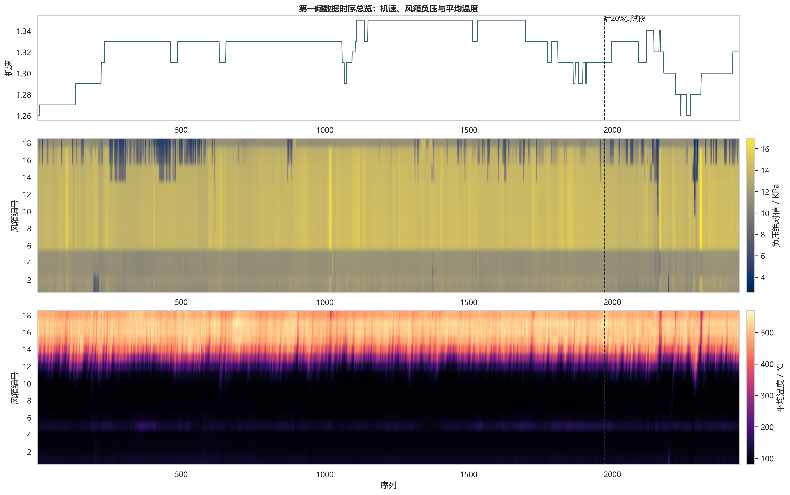
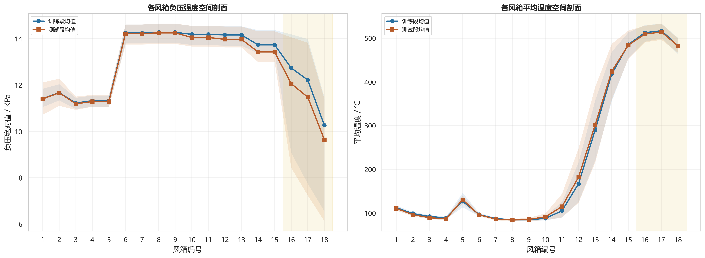
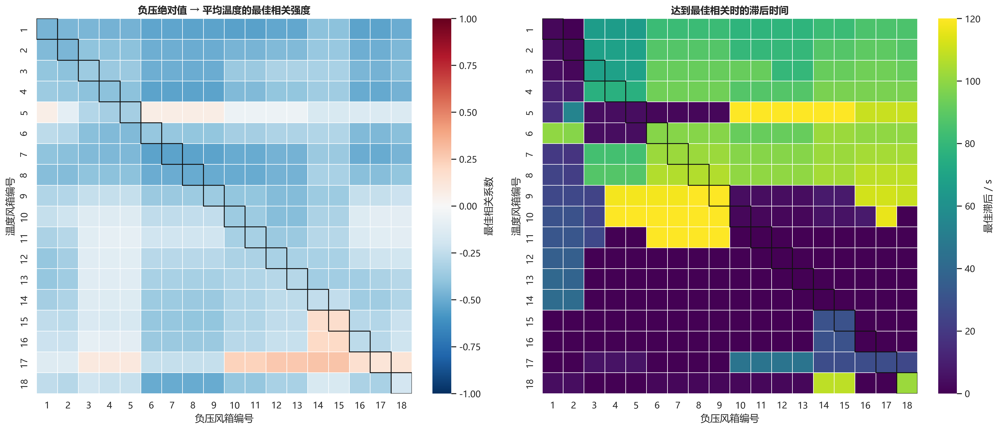
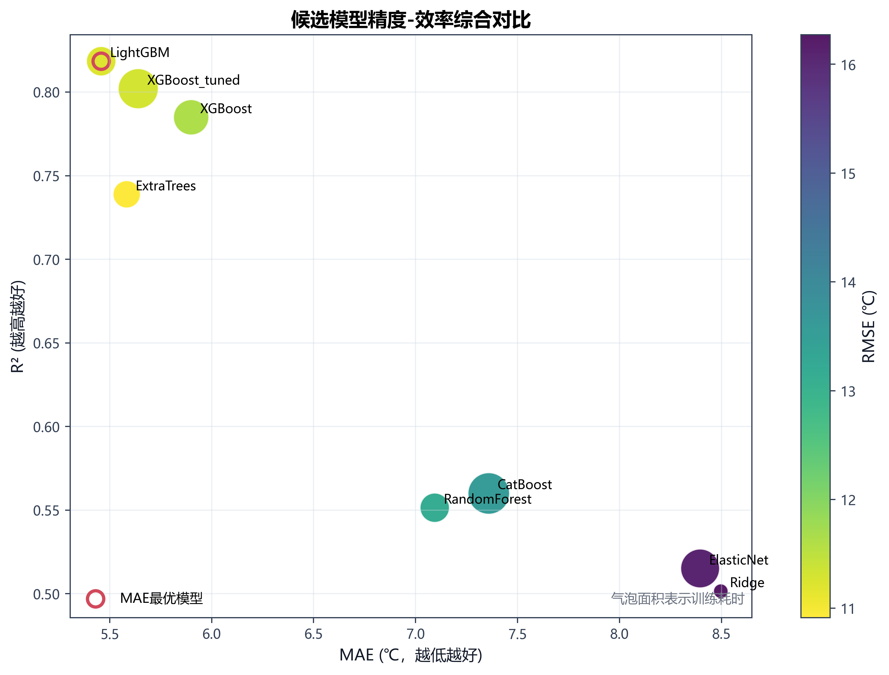
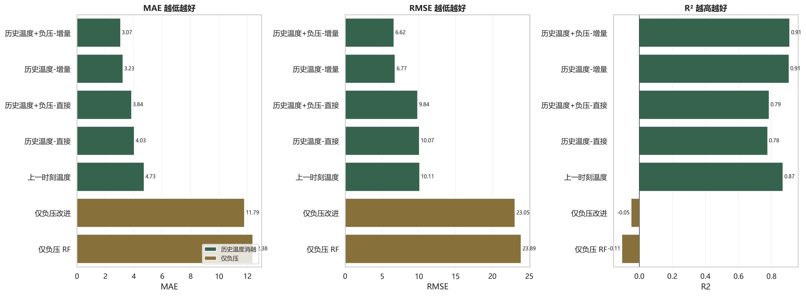
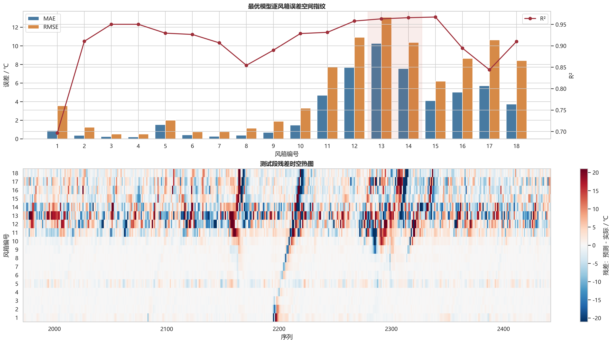
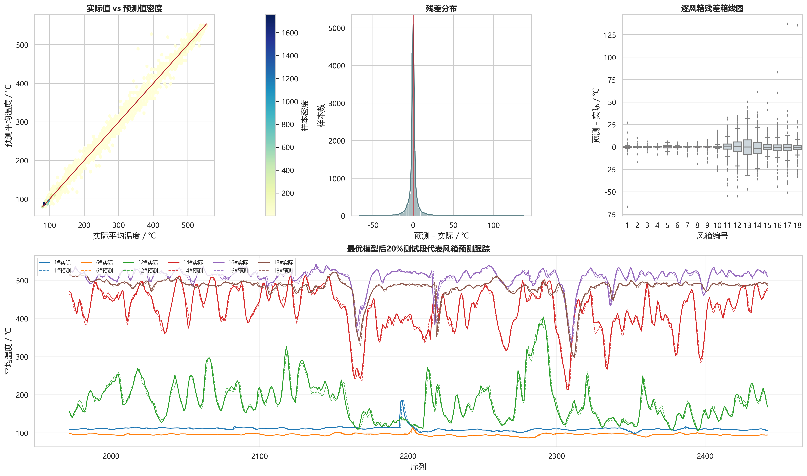
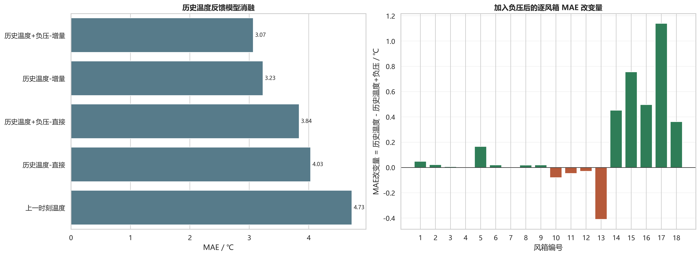

# 5.1 问题一：基于风箱负压的风箱温度预测模型

问题一要求探索各风箱负压与对应风箱温度之间的关系，并建立能够根据风箱负压实现对应温度精准预测的数学模型。根据题目提示，同一风箱南、北两侧温度可通过数据处理合并为一个温度指标。本文将第 \(i\) 个风箱的南北平均温度作为预测目标，在此基础上构建 18 个风箱的多输出温度预测模型。

烧结过程具有明显的时空耦合和热惯性特征。风箱负压反映不同位置的抽风强度和料层透气性，温度反映燃烧带推进和局部热状态，二者既存在空间对应关系，又受烧结机运行方向和热状态滞后的影响。因此，本文对问题一采用如下建模思路：首先分析风箱负压与风箱平均温度的空间剖面、动态时滞和非线性关系；其次建立仅使用机速、风箱负压及其派生特征的严格负压驱动模型，用于检验“基于风箱负压”预测温度的可行性；再次采用时间顺序划分检验真实在线场景下由过去预测未来的能力，并分析后期工况漂移对纯负压模型的影响；最后引入在线可获得的历史温度反馈，构建负压增强的温度增量模型，以提高温度预测精度。

## 5.1.1 数据处理与温度目标构造

附件 1 中共有 2442 个时间序列样本，相邻样本间隔为 2 s。与问题一直接相关的变量包括烧结机机速 L1 设定、1# 至 18# 风箱负压，以及 1# 至 18# 风箱南侧温度和北侧温度。大烟道负压、大烟道温度和烧结大烟道外排 CO 浓度属于后续问题中的关键变量，在问题一的负压驱动温度预测模型中不作为输入变量，以保证建模口径与问题要求一致。

设 \(P_i(t)\) 表示第 \(i\) 个风箱在时刻 \(t\) 的负压，\(T_i^S(t)\) 和 \(T_i^N(t)\) 分别表示该风箱南侧和北侧温度。根据题目给出的处理提示，将南、北两侧温度合成为风箱平均温度：

$$
T_i(t)=\frac{T_i^S(t)+T_i^N(t)}{2},\quad i=1,2,\ldots,18.
$$

于是，问题一的预测目标可表示为 18 维温度向量：

$$
\mathbf{y}(t)=\left[T_1(t),T_2(t),\ldots,T_{18}(t)\right]^{\mathsf T}.
$$

平均温度既符合题目要求，又能够削弱南北局部测点波动对整体风箱热状态表征的影响。经过该处理后，问题一可转化为一个以烧结机机速和多风箱负压为输入、以 18 个风箱平均温度为输出的多输出回归问题。

图 5-1 给出了机速、18 个风箱负压和 18 个风箱平均温度的时空分布。可以看出，不同风箱位置的负压水平与温度水平存在明显差异；同时，后 20% 样本段与前 80% 样本段的工况分布并不完全一致，这为后续采用时间顺序验证和工况漂移分析提供了依据。

表 5-1 给出了问题一采用的变量口径。

| 变量类型 | 符号或字段 | 数量 | 单位 | 问题一用途 |
| --- | --- | ---: | --- | --- |
| 时间序列编号 | \(t\) | 2442 | - | 描述 2 s 采样间隔，并用于时间顺序划分 |
| 烧结机机速 L1 设定 | \(v(t)\) | 1 | m/min | 作为运行状态输入变量 |
| 风箱负压 | \(P_i(t)\) | 18 | kPa | 核心输入变量 |
| 风箱南侧、北侧温度 | \(T_i^S(t),T_i^N(t)\) | 36 | \(^\circ\mathrm{C}\) | 合成为平均温度目标 |
| 风箱平均温度 | \(T_i(t)\) | 18 | \(^\circ\mathrm{C}\) | 问题一预测目标 |
| 大烟道变量及 CO 浓度 | - | 5 | kPa、\(^\circ\mathrm{C}\)、mg/m\(^3\) | 不进入问题一输入 |

## 5.1.2 负压-温度关系探索与时空特征构建

风箱负压为负值。为便于解释抽风强度，定义正向负压强度：

$$
A_i(t)=-P_i(t).
$$

当 \(A_i(t)\) 越大时，表示对应风箱的抽风强度越强。从空间剖面看，1# 至 18# 风箱沿烧结机方向形成了明显的负压强度分布和温度梯度。前段风箱温度整体较低，中后段温度升高并出现高温峰值，后段 16# 至 18# 风箱由于规格为 \(4\times2\) m，统计特征与 1# 至 15# 的 \(4\times4\) m 风箱存在差异。该现象说明，温度预测不能简单地把各风箱视为相互独立、同质的测点，而应体现风箱位置和空间邻域影响。

为了刻画负压变化对温度响应的动态影响，进一步计算第 \(i\) 个风箱负压强度与第 \(j\) 个风箱平均温度之间的滞后相关系数：

$$
r_{ij}(\ell)=\operatorname{corr}\left(A_i(t-\ell),T_j(t)\right),\quad \ell=0,1,\ldots,60.
$$

其中 \(\ell\) 为滞后步数，每一步对应 2 s，最大滞后窗口为 120 s。对每一组 \((i,j)\)，取绝对相关系数最大的滞后步数：

$$
\ell_{ij}^{*}=\arg\max_{\ell}|r_{ij}(\ell)|.
$$

图 5-3 的时滞关系矩阵表明，负压与温度之间并非简单的同风箱、同步线性关系。一方面，较强相关关系常出现在相邻或近邻风箱之间，说明抽风状态对局部热状态具有空间扩散和协同影响；另一方面，不同风箱组合的最佳滞后不同，说明负压变化对温度的影响存在时间传递过程。结合局部相图可观察到，在相近负压水平下，温度可能由于前期热状态不同而沿不同轨迹变化，表现出一定的滞回特征。这说明，仅使用当前负压难以完整描述温度状态，必须构造负压的时间滞后、变化趋势和空间邻域特征；在追求更高预测精度时，也有必要引入历史温度反馈。

在严格负压驱动模型中，输入特征只来自烧结机机速、18 个风箱负压及其派生量。首先，在时间维度上构造滞后特征、差分特征和变化速率特征。设滞后步长集合为 \(\tau\in\{1,5,10,30\}\)，分别对应 2 s、10 s、20 s 和 60 s，则有：

$$
\Delta_{\tau}P_i(t)=P_i(t)-P_i(t-\tau),
$$

$$
R_{\tau}P_i(t)=\frac{P_i(t)-P_i(t-\tau)}{2\tau}.
$$

其次，设置滚动窗口 \(w\in\{5,15,30\}\)，分别对应 10 s、30 s 和 60 s，提取滚动均值、滚动标准差和滚动极差等统计特征。例如：

$$
\overline{P}_{i,w}(t)=\frac{1}{w}\sum_{k=0}^{w-1}P_i(t-k).
$$

在空间维度上，构造相邻风箱负压差、局部邻域均值、局部极差、前段/中段/后段统计量，以及长风箱与短风箱分组统计量。经过滞后窗口和滚动窗口对齐后，严格负压模型最终得到 2412 条建模样本和 587 个输入特征。输入字段检查结果表明，该特征集不包含温度、CO、大烟道、南侧温度、北侧温度等相关字段，从而避免了目标泄露和跨问题变量混入。

表 5-2 总结了严格负压模型的主要特征构造方式。

| 特征类别 | 构造内容 | 作用 |
| --- | --- | --- |
| 原始运行特征 | 机速、18 个风箱负压 | 描述当前运行状态和抽风强度 |
| 时间滞后特征 | \(P_i(t-\tau)\)、\(v(t-\tau)\) | 表征负压和机速的历史状态 |
| 动态变化特征 | 差分、变化速率 | 捕捉工况变化方向和变化幅度 |
| 滚动统计特征 | 均值、标准差、极差 | 平滑局部噪声并反映短时波动 |
| 空间邻域特征 | 相邻风箱差值、局部均值、局部极差 | 描述沿烧结机方向的空间耦合 |
| 分段结构特征 | 前段、中段、后段、长短风箱统计 | 体现风箱位置和规格差异 |

## 5.1.3 严格负压驱动预测模型与随机验证

设严格负压特征向量为 \(\mathbf{x}_p(t)\in\mathbb{R}^{587}\)，输出为 18 个风箱平均温度向量 \(\mathbf{y}(t)\)。基础预测模型可表示为：

$$
\hat{\mathbf{y}}(t)=f_p(\mathbf{x}_p(t))+\boldsymbol{\varepsilon}(t),
$$

其中 \(f_p(\cdot)\) 表示由机速、风箱负压及其时空派生特征到风箱平均温度的非线性映射，\(\boldsymbol{\varepsilon}(t)\) 为预测残差。

模型评价采用 MAE、RMSE 和 \(R^2\) 三个指标。对测试集样本数 \(n\)、风箱数 \(m=18\)，定义：

$$
\mathrm{MAE}=\frac{1}{nm}\sum_{t=1}^{n}\sum_{i=1}^{m}\left|T_i(t)-\hat{T}_i(t)\right|,
$$

$$
\mathrm{RMSE}=\sqrt{\frac{1}{nm}\sum_{t=1}^{n}\sum_{i=1}^{m}\left(T_i(t)-\hat{T}_i(t)\right)^2}.
$$

\(R^2\) 用于衡量模型对温度波动的解释能力，越接近 1 表示预测效果越好。

为检验负压时空特征对温度的同分布拟合能力，首先采用随机 8:2 留出验证，并设置 5 折交叉验证复核最佳模型的稳定性。候选模型包括 Ridge、ElasticNet、RandomForest、ExtraTrees、LightGBM、CatBoost、XGBoost 以及调参后的 XGBoost。随机验证结果见表 5-3。

表 5-3 随机划分下候选模型预测性能比较

| 模型 | MAE | RMSE | \(R^2\) | 训练时间/s |
| --- | ---: | ---: | ---: | ---: |
| LightGBM | 5.4585 | 11.2224 | 0.8184 | 35.37 |
| ExtraTrees | 5.5838 | 10.9135 | 0.7388 | 20.18 |
| XGBoost_tuned | 6.2044 | 12.0934 | 0.7539 | 46.28 |
| XGBoost | 6.3686 | 12.3447 | 0.7358 | 40.45 |
| RandomForest | 7.0938 | 13.1597 | 0.5514 | 32.99 |
| CatBoost | 7.3586 | 13.5878 | 0.5599 | 143.53 |
| ElasticNet | 8.3948 | 16.0968 | 0.5151 | 122.39 |
| Ridge | 8.4961 | 16.2711 | 0.5015 | 0.11 |

由表 5-3 可知，LightGBM 在随机验证中取得最佳综合效果，MAE 为 5.4585，RMSE 为 11.2224，\(R^2\) 为 0.8184。进一步进行 5 折交叉验证，LightGBM 的 MAE 为 \(5.5421\pm0.0714\)，RMSE 为 \(11.4012\pm0.1664\)，\(R^2\) 为 \(0.8037\pm0.0158\)。交叉验证波动较小，说明负压及其时空特征与风箱平均温度之间存在稳定的可学习映射。

需要指出的是，随机划分会将前后时间段样本混合到训练集和测试集中，因此该实验主要用于证明负压-温度关系的可学习性和同分布插值能力，不能直接等价于真实在线预测精度。烧结过程属于连续时间序列，在线预测更关注用过去样本预测未来样本，因此仍需进行时间顺序验证。

## 5.1.4 时间顺序验证与工况漂移分析

为了更接近实际生产中的在线预测场景，本文采用前 80% 样本训练、后 20% 样本测试的时间顺序划分方式。该设置避免了未来样本信息进入训练集，能够检验模型在后续工况上的外推能力。

在时间顺序测试中，严格负压基础模型的预测误差明显增大。基础负压模型的 MAE 为 12.3781，RMSE 为 23.8890，\(R^2=-0.1056\)。这说明后 20% 测试段与前 80% 训练段之间存在明显工况漂移或关系漂移，仅依赖负压特征进行时间外推时存在精度上限。

针对该问题，进一步构建相对负压与局部误差校正模型。该模型仍然只使用负压和机速信息，不引入历史温度、大烟道变量或 CO 浓度；其主要思想是在负压特征层面引入相对负压刻画，弱化漂移较强的特征，对后段目标进行轻度加权，并对误差较大的 12# 至 14# 风箱采用单输出模型进行局部覆盖修正。校正后，模型 MAE 降至 11.7905，RMSE 降至 23.0480，\(R^2\) 提升至 -0.0500。该结果说明负压特征层面的漂移修正具有一定作用，但仍不能完全解释后期温度变化。

表 5-4 时间顺序验证下严格负压模型结果

| 模型 | 特征口径 | MAE | RMSE | \(R^2\) | 说明 |
| --- | --- | ---: | ---: | ---: | --- |
| 严格负压基础模型 | 仅机速、负压及其派生特征 | 12.3781 | 23.8890 | -0.1056 | 前 80% 训练、后 20% 测试 |
| 相对负压与局部误差校正模型 | 仅机速、负压及其校正特征 | 11.7905 | 23.0480 | -0.0500 | 对漂移和局部高误差风箱进行修正 |

从图 5-6 的逐风箱误差和残差时空分布可以看出，模型误差并非均匀分布，而是集中出现在中后段若干风箱和部分后期时间片段。该区域往往对应燃烧带高温区或烧结终点附近，温度对料层蓄热、燃烧带迁移和局部扰动更敏感。纯负压模型虽然能够描述抽风状态变化，但难以完整恢复系统的历史热状态。因此，随机验证和时间顺序验证结果并不矛盾：前者证明负压-温度映射具有同分布可学习性，后者说明在真实时间外推中，温度自身的历史状态是提高预测精度的重要信息。

## 5.1.5 面向精准预测的历史温度反馈增强模型

风箱温度是具有强连续性和惯性的热状态序列。上一时刻及近期历史温度中包含燃烧带位置、料层蓄热程度和局部扰动延续等信息；风箱负压则反映当前及近期抽风状态、料层透气性和操作扰动。为了在不使用未来温度标签的前提下提高在线预测精度，本文在严格负压模型基础上引入历史温度反馈，构建历史温度反馈的负压增强增量模型。

对每个风箱构造历史温度滞后特征：

$$
\mathbf{h}_T(t)=\left\{T_i(t-1),T_i(t-5),T_i(t-15),T_i(t-30),T_i(t-60)\right\}_{i=1}^{18}.
$$

其中滞后 1、5、15、30、60 步分别对应 2 s、10 s、30 s、60 s 和 120 s。增强模型不直接预测温度水平，而是预测当前温度相对于上一时刻的变化量：

$$
\Delta T_i(t)=T_i(t)-T_i(t-1).
$$

模型学习如下映射：

$$
\widehat{\Delta T_i(t)}
=g_i\left(\mathbf{h}_T(t),\mathbf{x}_p(t)\right),
$$

其中 \(\mathbf{h}_T(t)\) 为在线可获得的历史温度特征，\(\mathbf{x}_p(t)\) 为机速、负压及其时空派生特征。最终通过上一时刻真实温度还原当前温度：

$$
\hat{T}_i(t)=T_i(t-1)+\widehat{\Delta T_i(t)}.
$$

该模型的输出仍为当前风箱平均温度 \(\hat{T}_i(t)\)。与直接预测温度水平相比，预测 \(\Delta T_i(t)\) 能够将温度序列中的慢变基线交给上一时刻温度表示，使模型更专注于学习由负压扰动和热状态变化引起的增量部分。

为验证历史温度、负压特征和增量建模方式的贡献，设计五类消融实验：上一时刻温度持久性模型、仅历史温度直接预测当前温度、历史温度与负压共同直接预测当前温度、仅历史温度预测温度变化量、历史温度与负压共同预测温度变化量。结果见表 5-5。

表 5-5 历史温度反馈消融实验结果

| 模型 | 特征与预测方式 | 特征数 | MAE | RMSE | \(R^2\) |
| --- | --- | ---: | ---: | ---: | ---: |
| 历史温度+负压增量 LightGBM | 历史温度 + 负压，预测 \(\Delta T\) | 790 | 3.0670 | 6.6206 | 0.9097 |
| 历史温度增量 LightGBM | 仅历史温度，预测 \(\Delta T\) | 186 | 3.2302 | 6.7708 | 0.9054 |
| 历史温度+负压直接 LightGBM | 历史温度 + 负压，直接预测 \(T\) | 790 | 3.8394 | 9.8417 | 0.7856 |
| 历史温度直接 LightGBM | 仅历史温度，直接预测 \(T\) | 186 | 4.0322 | 10.0656 | 0.7762 |
| 持久性基准模型 | 仅使用上一时刻温度 | - | 4.7261 | 10.1055 | 0.8686 |

由表 5-5 可知，历史温度+负压的增量 LightGBM 效果最好，在后 20% 时间顺序测试集上达到 MAE 3.0670、RMSE 6.6206、\(R^2=0.9097\)。与持久性基准相比，该模型显著降低了预测误差，说明模型不仅利用了温度序列的连续性，也捕捉到了温度变化量中的非线性规律。与仅历史温度预测 \(\Delta T\) 的模型相比，加入负压后 MAE 从 3.2302 降至 3.0670，降低 0.1632，说明在温度自身惯性之外，负压仍然提供了额外的工况扰动信息。

图 5-7 展示了最优增强模型在测试集上的实际值与预测值一致性、残差分布和典型风箱跟踪曲线。多数样本点沿对角线分布，残差集中在零附近，表明模型能够较好地跟踪不同风箱温度变化。图 5-8 的消融结果进一步说明，历史温度反馈是提升在线预测精度的主要来源，而负压特征则在此基础上补充了抽风状态变化信息，使模型从“热状态惯性预测”进一步提升为“历史热状态与当前负压扰动共同驱动的温度预测”。

## 5.1.6 问题一模型小结

针对问题一，本文首先将各风箱南、北两侧温度合成为平均温度，将问题转化为 18 维多输出回归任务。通过空间剖面和时滞相关分析发现，风箱负压与风箱平均温度之间存在明显的空间耦合、时间滞后和非线性关系。负压能够刻画抽风状态和局部料层透气性，是预测风箱温度的重要在线变量；但负压对温度的影响不是简单同箱同步关系，需要结合时间滞后、动态变化和空间邻域特征进行建模。

严格负压驱动模型只使用机速、风箱负压及其派生特征，不引入历史温度、大烟道变量或 CO 浓度。在随机 8:2 验证中，LightGBM 模型取得 MAE 5.4585、RMSE 11.2224、\(R^2=0.8184\)，五折交叉验证结果为 MAE \(5.5421\pm0.0714\)，证明负压-温度映射具有稳定的可学习性。然而，在前 80% 训练、后 20% 测试的时间顺序验证下，严格负压基础模型 MAE 增大至 12.3781，说明后期工况漂移使纯负压时间外推存在上限。

为实现更高精度的在线温度预测，本文进一步引入历史温度反馈，并采用温度变化量建模。最终，历史温度+负压的增量 LightGBM 在时间顺序测试集上达到 MAE 3.0670、RMSE 6.6206、\(R^2=0.9097\)。消融实验表明，历史温度提供热状态惯性信息，负压提供额外工况扰动信息，二者结合能够显著提高风箱温度预测精度。

综上，问题一建立了“负压关系探索—严格负压驱动建模—时间外推检验—历史温度反馈增强”的完整建模框架。该框架既正面回答了风箱负压与风箱温度之间的关系，又为后续研究风箱负压、风箱温度、大烟道状态与 CO 排放之间的时滞配准和实时预测提供了中间热状态基础。
